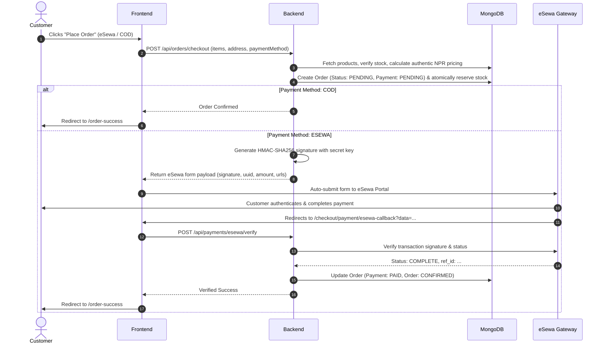

# OSOAA — Production-Ready Full-Stack E-Commerce Platform

> **"A Journey of Wellness"** — Premium Wellness, Sports Nutrition & Gym Accessories E-Commerce Platform engineered specifically for the Nepalese market.

---

## 1. System Overview

**OSOAA** is a decoupled full-stack MERN application developed for selling gym, fitness, wellness, and nutrition supplements in Nepal. 

### Key Capabilities
* **Nepalese Market Localization:** Native Nepalese Rupees (`Rs.` / `NPR`) throughout calculations, Nepalese administrative boundaries (Provinces 1–7, Districts, Municipalities, Wards), and localized courier tracking.
* **Verified Email Registration (OTP):** 6-digit numeric cryptographic OTP verification with 10-minute TTL, bcrypt hashed storage, and 60-second cooldown prior to customer account activation.
* **Server-to-Server eSewa & COD Payments:** eSewa EPAY v2 HMAC-SHA256 signature generation and backend server-to-server transaction verification alongside Cash on Delivery (COD).
* **DFTQC Quality Standards & Compliance:** Admin-configurable section highlighting compliance with Nepal's Department of Food Technology and Quality Control (DFTQC) quality testing standards for protein purity, heavy metals screening, and zero banned substances.
* **Atomic Inventory & Price Security:** Zero-trust architecture calculating authentic line item totals and stock reservations on the backend with rollback upon order cancellation.
* **Comprehensive Admin Control Portal:** Full management suite for products, categories, brands, orders, customer spend history, reviews moderation, coupons, hero banners, and business settings.

---

## 2. Tech Stack

### Frontend
* **Framework:** React 18 / 19 with Vite
* **Styling:** Tailwind CSS (Athletic Emerald & Slate Dark Mode design system)
* **Routing:** React Router v6
* **State Management:** Zustand (Auth, Persistent Cart, Wishlist, Business Settings)
* **Data Fetching:** TanStack React Query & Axios with cookie interceptors
* **Icons:** Lucide React

### Backend
* **Runtime:** Node.js (ES Modules: `import/export`)
* **Framework:** Express.js
* **Database:** MongoDB & Mongoose ODM
* **Authentication:** JWT via HTTP-only secure cookies + bcryptjs password hashing
* **Media Assets:** Cloudinary SDK with dev fallback
* **Security & Reliability:** Helmet, CORS, Express Rate Limiters, Morgan, Centralized Error Handling

---

## 3. Project Directory Structure

```text
OSOAA_development/
├── backend/
│   ├── src/
│   │   ├── config/             # DB, Environment variables, Cloudinary configs
│   │   ├── controllers/        # Auth, Product, Order, Payment, Admin, Settings, etc.
│   │   ├── middleware/         # Auth, RateLimiter, Upload, Centralized ErrorHandler
│   │   ├── models/             # User, Otp, Product, Category, Brand, Order, Review, Coupon, Wishlist, Banner, BusinessSettings
│   │   ├── routes/             # RESTful API route definitions
│   │   ├── services/           # Reusable business logic (Auth, OTP, Email, Order, Inventory, Payment, Cloudinary)
│   │   ├── utils/              # Development database seeder
│   │   └── server.js           # Express app setup and graceful server lifecycle
│   ├── .env.example
│   └── package.json
│
├── frontend/
│   ├── src/
│   │   ├── assets/             # Branding graphics and fallbacks
│   │   ├── components/         # Layout (Navbar, Footer, AnnouncementBar), Product, Cart, Trust, Admin
│   │   ├── constants/          # Nepal Provinces and Districts dataset
│   │   ├── layouts/            # RootLayout, AccountLayout, AdminLayout
│   │   ├── pages/              # Home, Shop, ProductDetail, Auth, Checkout, Account, Admin pages
│   │   ├── services/           # Axios instance with interceptors
│   │   ├── store/              # Zustand stores (auth, cart, wishlist, settings)
│   │   ├── utils/              # Nepalese currency formatter (NPR)
│   │   ├── App.jsx             # Comprehensive client routing
│   │   ├── index.css           # Custom scrollbars, design tokens, Tailwind directives
│   │   └── main.jsx            # QueryClient and BrowserRouter bootstrap
│   ├── vite.config.js
│   ├── tailwind.config.js
│   └── package.json
│
├── .gitignore
└── README.md
```

---

## 4. Environment Variables Configuration

### Backend (`backend/.env`)
```env
NODE_ENV=development
PORT=5000
CLIENT_URL=http://localhost:5173

MONGODB_URI=mongodb://127.0.0.1:27017/osoaa_db

JWT_SECRET=your_super_secret_jwt_key_min32chars
JWT_EXPIRES_IN=7d
COOKIE_EXPIRES_IN_DAYS=7

# Email Service (SMTP)
SMTP_HOST=smtp.gmail.com
SMTP_PORT=587
SMTP_USER=your-email@gmail.com
SMTP_PASS=your-email-app-password
EMAIL_FROM="OSOAA Wellness & Nutrition <no-reply@osoaa.com>"

# Cloudinary Media Management
CLOUDINARY_CLOUD_NAME=your_cloud_name
CLOUDINARY_API_KEY=your_api_key
CLOUDINARY_API_SECRET=your_api_secret

# eSewa EPAY v2 Credentials (Test keys provided by default)
ESEWA_PRODUCT_CODE=EPAYTEST
ESEWA_SECRET_KEY=8gBm/:&EnhH.1/q
ESEWA_PAYMENT_URL=https://rc-epay.esewa.com.np/api/epay/main/v2/form
ESEWA_VERIFY_URL=https://rc.esewa.com.np/api/epay/transaction/status/
```

### Frontend (`frontend/.env`)
```env
VITE_API_BASE_URL=/api
```

---

## 5. Local Setup & Quickstart

### Prerequisites
* Node.js v18+ (tested on v24)
* MongoDB (running locally on port 27017 or MongoDB Atlas connection string)

### Step 1: Install Backend Dependencies
```bash
cd backend
npm install
```

### Step 2: Seed Database & Create Production Admin
Populate business settings, sample categories, banners, coupons, and products:
```bash
npm run seed
```
To securely provision or synchronize the production owner admin account:
```bash
# Set ADMIN_EMAIL and ADMIN_PASSWORD in backend/.env, then run:
npm run create-admin
```
* **Coupons:** `WELCOME10` (10% off), `FITNESS500` (Rs. 500 off)

### Step 3: Start Backend Dev Server
```bash
npm run dev
# Running on http://localhost:5000
```

### Step 4: Install & Start Frontend Dev Server
In a separate terminal:
```bash
cd frontend
npm install
npm run dev
# Running on http://localhost:5173
```

---

## 6. Payment & Security Flow



---

## 7. Production Deployment Instructions

### Production Build
```bash
# Build optimized frontend bundle
cd frontend
npm run build

# Start production server
cd ../backend
NODE_ENV=production npm start
```

### Docker / PM2 Deployment
* In production, the Node.js backend serves both the `/api/*` endpoints and the static compiled frontend from `frontend/dist`.
* Configure PM2 with: `pm2 start src/server.js --name osoaa-backend -i max`.
* Ensure SSL/TLS is terminated at the reverse proxy (Nginx / Cloudflare / Caddy).

---

## 8. DFTQC Quality Standards Administration

* All quality standards and compliance details are managed through the Admin Portal under **Business & DFTQC Settings** (`/admin/settings`).
* Factual parameters include:
  * Quality / Laboratory Standard Name
  * Official Certificate / Standard Reference Number
  * Scope of Quality Testing (Protein concentration, heavy metals, banned substances)
  * Certificate document URL / public link
* Disclaimers are maintained in strict alignment with client documentation.
